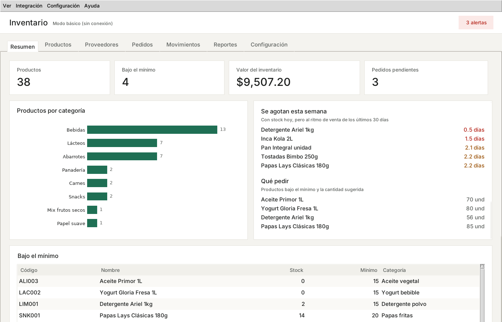
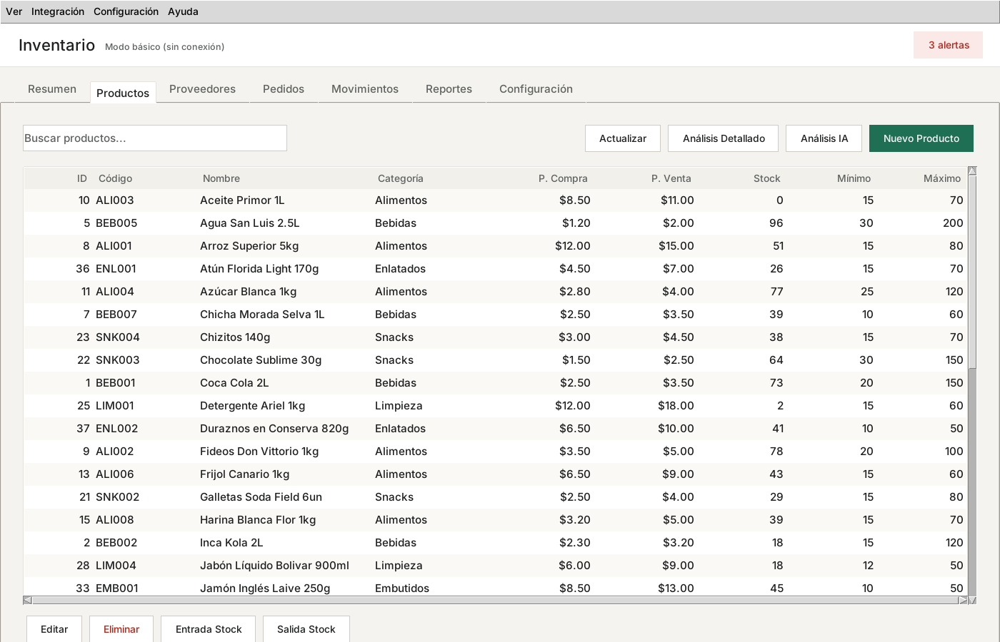
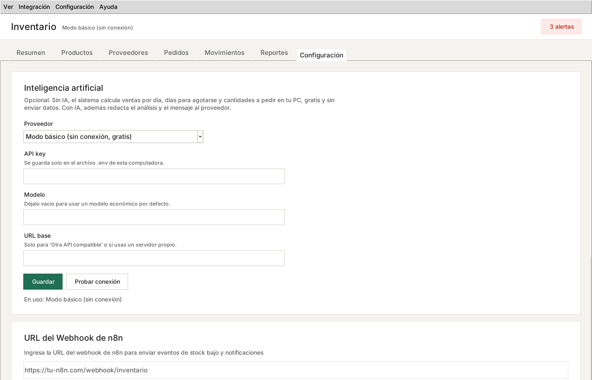

# Inventario IA

Inventario para negocios pequeños y medianos: minimarkets, bodegas, tiendas de barrio, ferreterías.
Te dice **qué se va a agotar esta semana, qué pedir y cuánto**, con o sin inteligencia artificial.

Funciona en tu computadora, sin internet y sin suscripción. Si quieres, conectas la IA que prefieras
(ChatGPT, Claude, Gemini, un modelo gratis en tu PC…) pegando tu API key en la configuración.

*[English summary below](#english)*



## Para quién es

- Tienes un negocio con decenas o cientos de productos y llevas el stock en un cuaderno o en Excel.
- Te pasa que algo se agota antes de que te des cuenta, o pides de más y se vence.
- Quieres algo simple, en tu PC, que no te cobre todos los meses.

No es un sistema de punto de venta ni de facturación. Es para controlar stock y decidir compras.

## Qué hace

- **Productos y proveedores**: altas, bajas, precios de compra y venta, stock mínimo y máximo.
- **Entradas y salidas** de stock con historial.
- **Se agotan esta semana**: calcula cuántos días le quedan a cada producto según lo que vendes.
- **Qué pedir**: cantidad sugerida para cada producto bajo el mínimo, sin pasarse del máximo.
- **Pedidos automáticos** al proveedor, con un mensaje listo para copiar y enviar.
- **Vencimientos**: fecha de ingreso, fecha de vencimiento y alertas.
- **Reportes** de stock, valor del inventario y movimientos. Importa y exporta Excel/CSV.
- **API y n8n** (opcional) para automatizar avisos por WhatsApp, email o Telegram.
- Tema claro y oscuro.

| Productos | Configuración de IA |
|---|---|
|  |  |

## Cómo funciona la "IA" (sin letra chica)

El sistema tiene dos modos:

**Modo básico (por defecto, gratis, sin internet).** Todo se calcula en tu PC con reglas claras:

1. Ventas por día = unidades vendidas en los últimos 30 días ÷ 30
2. Días para agotarse = stock actual ÷ ventas por día
3. Cantidad a pedir = llenar hasta ~85% del stock máximo, ajustado por rotación y urgencia,
   y siempre entre *lo necesario para llegar al mínimo* y *lo que cabe hasta el máximo*.

No es magia ni un modelo entrenado, y para un negocio pequeño suele ser justo lo que hace falta.

**Modo IA (opcional).** Eliges un proveedor en *Configuración → Inteligencia artificial* y pegas tu
API key. Los números base se siguen calculando en tu PC (un modelo de lenguaje no es confiable para
hacer cuentas); la IA redacta el análisis, escribe el mensaje al proveedor y puede ajustar la cantidad,
pero **nunca fuera de los límites** de mínimo y máximo. Si la IA falla o no hay internet, el sistema
vuelve solo al modo básico.

Proveedores soportados: OpenAI, Anthropic (Claude), Google Gemini, Groq, OpenRouter, DeepSeek,
Mistral, Together, **Ollama y LM Studio** (modelos gratis que corren en tu propia PC) y cualquier API
compatible con OpenAI.

> Al usar una IA externa se envían a ese proveedor los datos del producto que se analiza (nombre,
> stock, ventas, proveedor). Si no quieres que salgan de tu PC, usa el modo básico u Ollama.

## Instalación (Windows)

1. Instala [Python 3.10 o superior](https://www.python.org/downloads/). Durante la instalación marca
   **"Add Python to PATH"**.
2. Descarga este proyecto (botón verde **Code → Download ZIP**) y descomprímelo.
3. Abre una terminal en la carpeta y ejecuta:

   ```bash
   pip install -r requirements.txt
   ```

4. (Opcional) Carga datos de ejemplo para probar: `python generar_datos_prueba.py`
   *Ojo: borra los datos existentes. Úsalo solo en una instalación nueva.*
5. Abre el programa con doble clic en **`ABRIR_INVENTARIO.bat`** (o `python main.py`).

En Mac y Linux funciona igual con `python3 main.py`. En Linux puede que necesites `sudo apt install python3-tk`.

**¿Ya tenías una copia anterior de este proyecto?** Las versiones viejas guardaban `inventario.db` dentro
del repositorio. Antes de actualizar, copia ese archivo a otro lugar: ahí están tus datos.

¿Quieres un `.exe` para una PC sin Python? Ejecuta `python crear_ejecutable.py` y copia la carpeta
`dist/Inventario`.

## Configuración

Toda la configuración vive en un archivo `.env` que **nunca se sube a GitHub**. Copia `.env.example`
como `.env`. La IA también se configura desde la propia app, que escribe en ese archivo.

| Variable | Para qué | Por defecto |
|---|---|---|
| `AI_PROVIDER` | `local`, `openai`, `anthropic`, `gemini`, `ollama`… | `local` |
| `AI_API_KEY` | Tu clave del proveedor de IA | vacío |
| `AI_MODEL` | Modelo a usar (vacío = uno económico) | vacío |
| `API_TOKEN` | Clave para la API (n8n), mínimo 24 caracteres | aleatoria en cada arranque |
| `API_HOST` | `127.0.0.1` = solo esta PC | `127.0.0.1` |
| `INVENTARIO_DB` | Ruta de la base de datos | `inventario.db` |

Tus datos quedan en `inventario.db` (SQLite) en tu PC. Haz copias de seguridad de ese archivo.

## API y automatizaciones con n8n (opcional)

```bash
python api_rest.py
```

Levanta una API en `http://127.0.0.1:5000` (documentación en `/api/docs`). Todas las rutas, salvo
`/api/health` y `/api/docs`, piden la cabecera `Authorization: Bearer <API_TOKEN>`.

Guías: [docs/N8N.md](docs/N8N.md), [docs/N8N_IA.md](docs/N8N_IA.md) y [docs/INTEGRACION.md](docs/INTEGRACION.md).

**Seguridad:** por defecto la API solo escucha en tu propia PC y sin modo debug. Si n8n corre en otra
computadora, usa `API_HOST=0.0.0.0` solo dentro de tu red local y con un `API_TOKEN` largo. Nunca
expongas el puerto a internet.

## Estructura

```
main.py                 Aplicación de escritorio (Tkinter)
ui_kit.py               Sistema visual: botones, roles y colores
theme_manager.py        Temas claro y oscuro
ai_assistant.py         Cálculo de pedidos sugeridos (+ IA opcional)
ai_provider.py          Conexión con OpenAI, Claude, Gemini, Ollama, etc.
analizador_ia.py        Estadísticas de ventas, categorías y promociones
database.py, models.py  Base de datos SQLite
api_rest.py             API REST (incluye los endpoints de n8n)
config.py, env_store.py Configuración desde .env
tests/                  Pruebas automáticas
```

## Desarrollo

```bash
pip install -r requirements.txt pytest
python -m pytest
```

Ideas y errores: abre un *issue*. Las contribuciones son bienvenidas; mantén el estilo simple y en
español, y agrega un test si cambias la lógica de pedidos.

**Pendiente / ideas:** dividir `main.py` en módulos, lector de código de barras, multi-sucursal,
historial de precios por proveedor.

## Licencia

[MIT](LICENSE). Úsalo, modifícalo y compártelo, también con fines comerciales.

---

## English

**Inventario IA** is a free, offline desktop inventory app for small shops (minimarkets, corner
stores, hardware stores). It tracks products, suppliers and stock movements, and tells you **what will
run out this week and how much to reorder**.

- **Basic mode (default):** transparent, rule-based forecasting that runs locally. No internet, no
  cost, no data leaves your PC.
- **AI mode (optional):** paste an API key for OpenAI, Anthropic, Gemini, Groq, OpenRouter, DeepSeek,
  Mistral, or run a free local model with Ollama / LM Studio. Base numbers are still computed locally;
  the AI writes the analysis and the supplier message and may adjust the quantity within min/max
  limits. It falls back to basic mode on any error.

Install: Python 3.10+, `pip install -r requirements.txt`, `python main.py`. Optional REST API for n8n
with token auth, bound to localhost by default. UI is in Spanish. MIT licensed.
